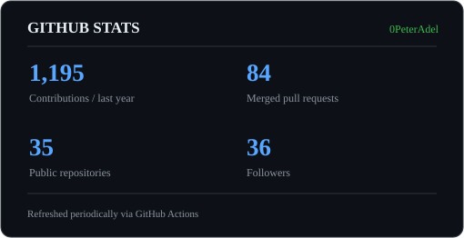

<h2 align="center">Hi 👋! My name is Peter  and I'm Developer passionate about computer science, artificial intelligence and Cyper security</h2>

###

<picture>
  <source media="(prefers-color-scheme: dark)" srcset="https://raw.githubusercontent.com/0PeterAdel/0PeterAdel/output/github-snake-dark.svg" />
  <source media="(prefers-color-scheme: light)" srcset="https://raw.githubusercontent.com/0PeterAdel/0PeterAdel/output/github-snake.svg" />
  
</picture>

###

  
  
  
  
  
  
  
  
  
  
  
  
  
  
  
  
  
  
  
  
  
  
  
  
  
  
  
  
  
  
  
  
  
  
  
  
  
  
  

###

  
  
  
  

###

<!-- OPEN SOURCE CONTRIBUTIONS START -->
<h3 align="center">🌍 Open Source Contributions</h3>

Verified merged pull requests in external communities · Refreshed automatically via GitHub Actions

<table align="center">
  <tr>
    <td align="center" valign="top" width="50%">
      
      
<b>5 merged PRs</b> fix(wgsl): write f32tof16 and f16tof32 with pack2x16float and unpack2x16float

       &nbsp;  &nbsp;  &nbsp;  &nbsp; <small>+1 more merged PRs</small>
    </td>
    <td align="center" valign="top" width="50%">
      
      
<b>5 merged PRs</b> [Staples CA] Filter wireless service locations

       &nbsp;  &nbsp;  &nbsp;  &nbsp; <small>+1 more merged PRs</small>
    </td>
  </tr>
  <tr>
    <td align="center" valign="top" colspan="2" width="100%">
      
      
<b>1 merged PR</b> fix(keyboard): preserve Static color readback and report apply failures

      
    </td>
  </tr>
</table>

⏳ Open external pull requests (7)

<ul>
<li><a href="https://github.com/CrossGL/crosstl/pull/4419">CrossGL/crosstl #4419</a> — fix(codegen): type WaveReadLaneAt lane arguments independently of the value</li>
<li><a href="https://github.com/huggingface/huggingface_hub/pull/5338">huggingface/huggingface_hub #5338</a> — [Docs] Fix get_discussion_details example in community guide</li>
<li><a href="https://github.com/mozilla-ai/any-llm/pull/1631">mozilla-ai/any-llm #1631</a> — fix(groq): allow supported structured output streaming</li>
<li><a href="https://github.com/PXDiv/Div-Linuwu-Sense/pull/31">PXDiv/Div-Linuwu-Sense #31</a> — fix(keyboard): enable true Static lighting on PHN16-72</li>
<li><a href="https://github.com/linux-do/override/pull/94">linux-do/override #94</a> — security: stop logging code completion API keys</li>
<li><a href="https://github.com/PXDiv/Div-Linuwu-Sense/pull/20">PXDiv/Div-Linuwu-Sense #20</a> — feat(predator): add PHN16-72 back logo/lightbar support</li>
<li><a href="https://github.com/PXDiv/Div-Acer-Manager-Max/pull/214">PXDiv/Div-Acer-Manager-Max #214</a> — feat(predator): add PHN16-72 back logo/lightbar controls</li>
</ul>

<a href="https://github.com/pulls?q=is%3Apr%20is%3Aopen%20author%3A0PeterAdel">View all open PRs</a>

Last refreshed: 2026-11-13 21:24 UTC

<!-- OPEN SOURCE CONTRIBUTIONS END -->

###

 

  

 

<!--   stats -->

  <table>
    <tr>
      <td>
        
      </td>
      <td>
        
      </td>
    </tr>
  </table>

  <h3>
      <a href="https://peteradel.netlify.app" target="_blank">
      Check out my portfolio: PeterAdel
      </a
  <h3>

  

